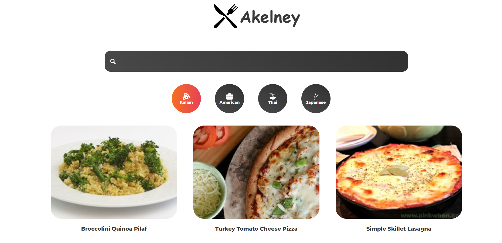

# Akelney — Recipe Finder



A recipe browser built on the [Spoonacular](https://spoonacular.com/food-api)
API. Browse random picks and vegetarian dishes in carousels, filter by cuisine,
search by keyword, and open a recipe for its ingredients and instructions.

## Features

- **Popular Picks** and **Vegetarian Picks** carousels on the home page
- **Cuisine pages** — Italian, American, Thai, Japanese, and so on, each a route
- **Keyword search** with its own results page
- **Recipe detail** with a tabbed switch between ingredients and instructions
- **Animated route transitions** via Framer Motion
- Responsive layout throughout

## Stack

| | |
| --- | --- |
| Framework | React 17 (Create React App) |
| Routing | React Router v6 |
| Styling | styled-components |
| Animation | Framer Motion |
| Carousels | [Splide](https://splidejs.com) |
| Icons | react-icons |
| Data | Spoonacular API |

## The one interesting problem

Spoonacular's free tier is metered in points per day, and a carousel that
refetches thirty random recipes on every mount burns through it in an
afternoon. So each fetch checks `localStorage` first and only calls the API on
a miss:

```jsx
const getPopular = async () => {
  const check = localStorage.getItem('popular')
  if (check) {
    setPopular(JSON.parse(check))
  } else {
    const api = await fetch(
      `https://api.spoonacular.com/recipes/random?apiKey=${process.env.REACT_APP_API_KEY}&number=30`
    )
    const data = await api.json()
    localStorage.setItem('popular', JSON.stringify(data.recipes))
    setPopular(data.recipes)
  }
}
```

That is a real fix for a real constraint, and it is worth knowing what it costs:

- **The cache never expires.** Once written, "Popular Picks" is frozen for that
  browser forever. Storing a timestamp alongside the payload and treating
  anything older than a day as a miss would keep the saving and lose the
  staleness.
- **A failed request poisons nothing, but it shows nothing either.** There is
  no `catch` and no check on `response.ok`, so an over-quota response resolves
  into an empty carousel with no explanation.

## Running locally

```bash
git clone https://github.com/Vette1123/Akelney-React-App.git
cd Akelney-React-App
npm install
```

Get a free key from [spoonacular.com/food-api](https://spoonacular.com/food-api)
and put it in `.env`:

```bash
REACT_APP_API_KEY=your_key_here
```

```bash
npm start
```

The app runs at `http://localhost:3000`.

> **Note:** the key is read in the browser, so it ships in the bundle. That is
> fine for a demo on a free tier and wrong for anything metered against a card
> — the fix is a small server route that holds the key and proxies the call.

---

Built by [Mohamed Gado](https://mohamedgado.com) · 2022
